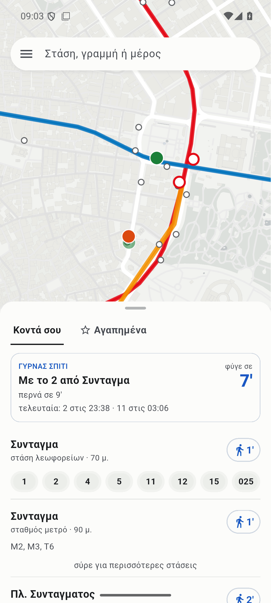
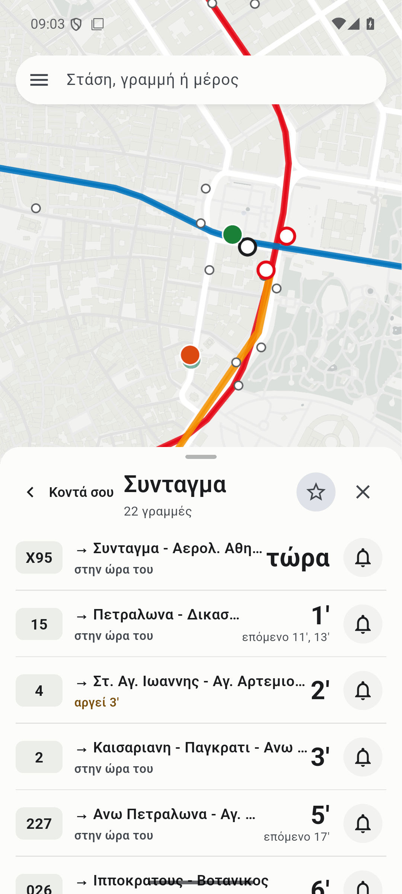
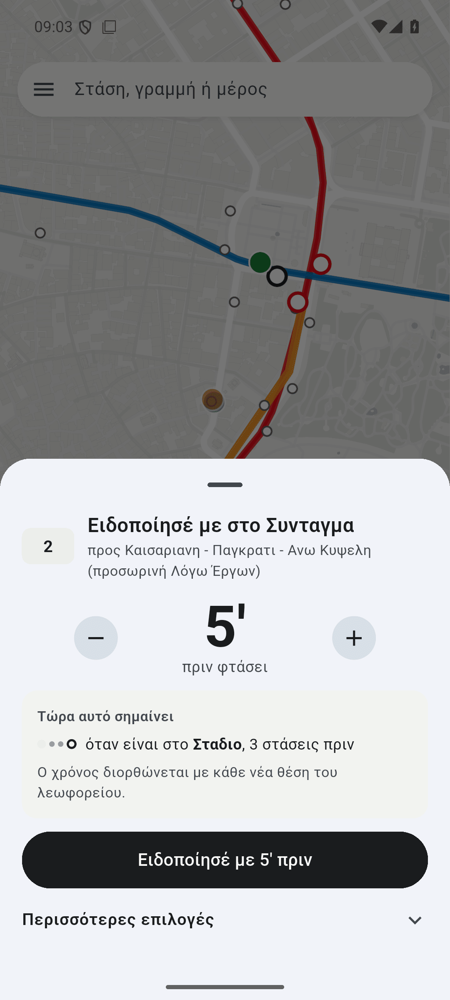
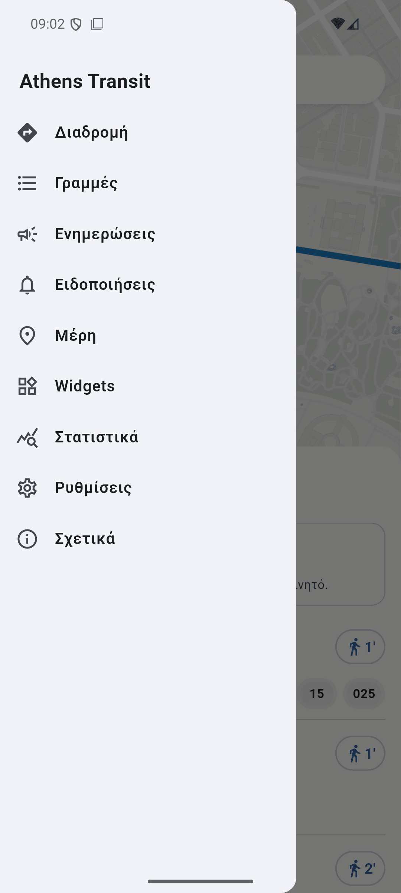
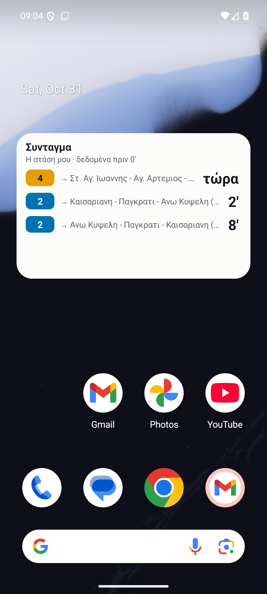

# Athens Transit (app)

Flutter app for the Athens bus map: live buses, arrivals at your stops, and alerts that keep running
with the app closed. Android first; the code is shared with iOS.

<p>
  
  
  
  
  
</p>

Home · stop · alert · menu · home-screen widget (v0.3.0, Android emulator, live data; the emulator does
not draw the map's street names).

What it does:

- **Home**: a full-screen map with one sheet: «Κοντά σου» (the nearest stops and stations with their
  next buses and trains) and «Αγαπημένα», a smart card («Γυρνάς σπίτι», «Πάμε δουλειά»), and the menu
  from the left.
- **Map**: every bus of the city live, coloured by delay, moving along its route between GPS fixes;
  metro, tram and suburban rail stations with their next trains.
- **Stops and lines**: next arrivals live, runs not started yet from today's timetable, runs that did
  not start («Δεν ξεκίνησαν») with another option; a line's timetable with each run seen or missed,
  the gaps between its buses and slow stretches ahead.
- **Διαδρομή (planner)**: bus without or with one change, bus + metro; a step-by-step screen with the
  next bus live, «φύγε σε N′», «Πού κατεβαίνω;» and «Ακολούθησέ με».
- **Alerts that run with the app closed**: minutes or stops before the bus, «Φύγε εγκαίρως» from your
  position, «Πες μου και αν αργεί», weekly rules, a live card on the lock screen, «Πού κατεβαίνω;» (one
  stop before you get off), «Ακολούθησέ με» (notices when you board), the last bus of the day and a
  Friday/Saturday evening suggestion for the last bus home.
- **Αγαπημένα** and **Μέρη** (named places, kept on the phone), network statistics, home-screen widgets
  «Η στάση μου» and «Γυρνάς σπίτι».

Changes per version: [CHANGELOG.md](CHANGELOG.md). Manual test list: [docs/TEST-CHECKLIST.md](docs/TEST-CHECKLIST.md).

Sibling projects:

| Repo | Local path | What |
|---|---|---|
| [athens-transit-map](https://github.com/angelospk/athens-transit-map) | `~/athens-transit-map` | The web map (bus.haroldpoi.dev). Source of `trips.json` and `metro.json`. |
| [athens-transit-rt](https://github.com/angelospk/athens-transit-rt) | `~/athens-transit-rt` | Go backend (transit.haroldpoi.dev) and static GTFS data. Owns the API contract: `docs/CONTRACT.md`. |

## Install

Signed APKs are on the [releases page](https://github.com/angelospk/athens-transit-app/releases):
`arm64-v8a` for most phones, `armeabi-v7a` for older ones, `universal` when unsure. Release
certificate SHA-256: `1F:D3:91:FC:BA:70:5F:B3:A6:48:F1:4D:D6:55:B0:AB:10:BF:BC:6F:95:09:5C:EC:CE:1C:3C:AD:90:B5:A7:63`.

A `v*` tag builds and publishes them (`.github/workflows/release.yml`); the tag message is the release
notes. The signing key is not in the repo: CI reads it from the `ANDROID_KEYSTORE_B64` and
`ANDROID_KEYSTORE_PASSWORD` secrets, local builds from `~/.config/athens-transit-app/key.properties`
(without it, release builds use the debug key). Losing the key means no updates for installed copies.

## Data

- Live: `https://transit.haroldpoi.dev/v1/lines/{id}` for the user's lines (max 5, as the contract asks)
  and `/v1/vehicles/tiles/{z}/{x}/{y}` for the map view.
- Timetables and rail (same backend): `/v1/lines/{id}/schedule` (today's OASA timetable, `seen` per
  run), `/v1/rail/stasy/departures` (metro, tram), `/v1/rail/suburban/...` (suburban rail, live).
  API reference: [docs/API.md](https://github.com/angelospk/athens-transit-rt/blob/main/docs/API.md).
- Static: `https://angelospk.github.io/athens-transit-rt/static/v1/` (lines, shapes, stops).
- Stop index: `https://bus.haroldpoi.dev/trips.json` (every stop with the lines that stop there).
- Map: OpenFreeMap vector styles (OpenStreetMap data) through MapLibre, as on the web.

Static files and the last live copy of each line are cached on disk; without a network the times are
estimates from that copy (shown with `~`).

## Layout

- `lib/core/` — pure Dart, tested: models, geometry, ETA from typical speeds (`path_speeds`), nearby
  stops, Athens time, alert rules and the watcher that fires each trip once.
- `lib/data/` — HTTP, disk cache, saved state, live polling.
- `lib/background/` — the foreground service that watches active rules (a notification per trip, an
  ongoing "live" notification; with the location type while a trip is followed, to notice boarding),
  the exact alarm that starts it for weekly rules, and the alarms for time notes (the last bus).
- `lib/ui/` — screens from the mockups (claude.ai artifact "Athens Transit App mockups").

## Run

```bash
flutter pub get
flutter test
flutter run
```

Builds need JDK 21 (`flutter config --jdk-dir <jdk21>`).
